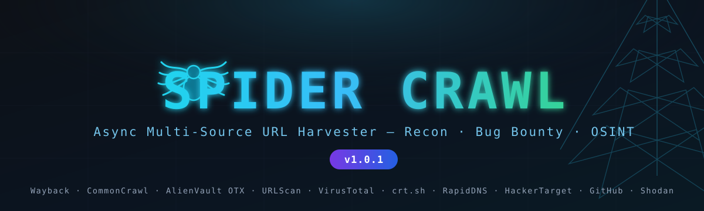
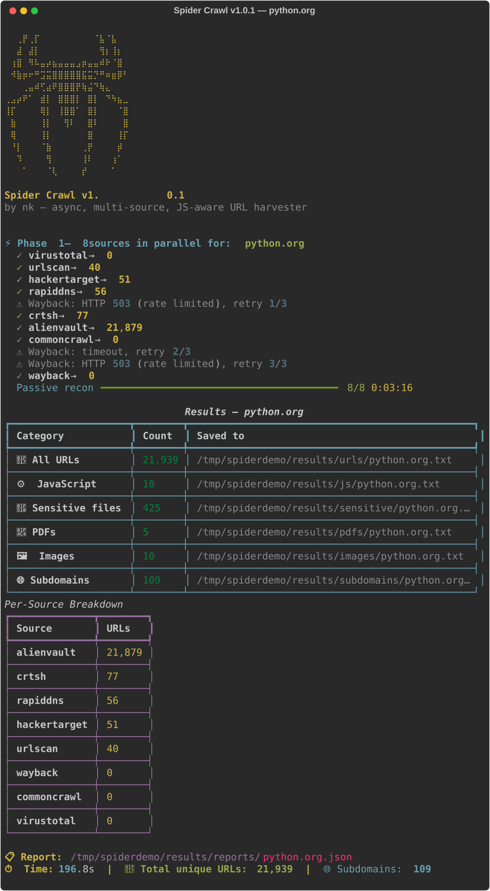
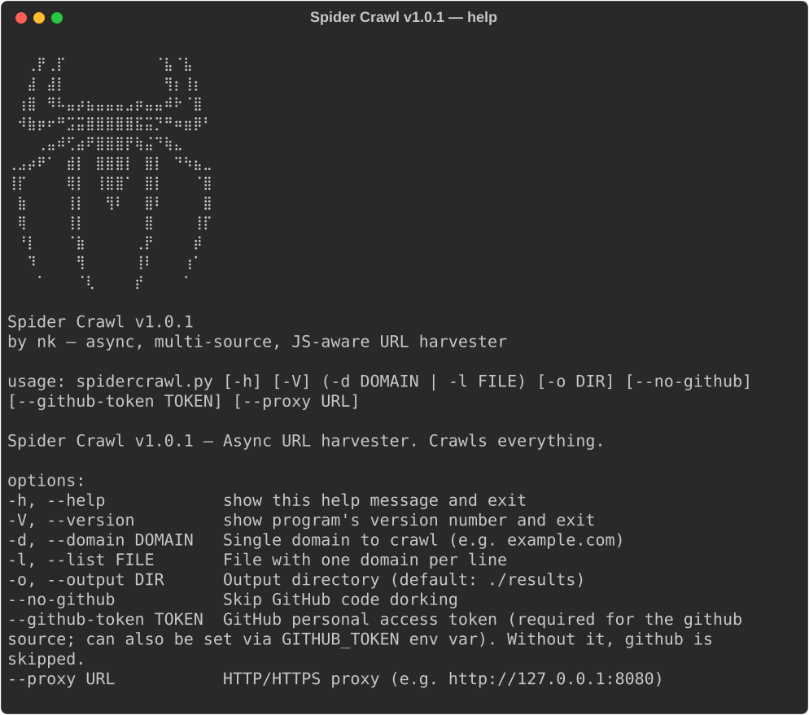
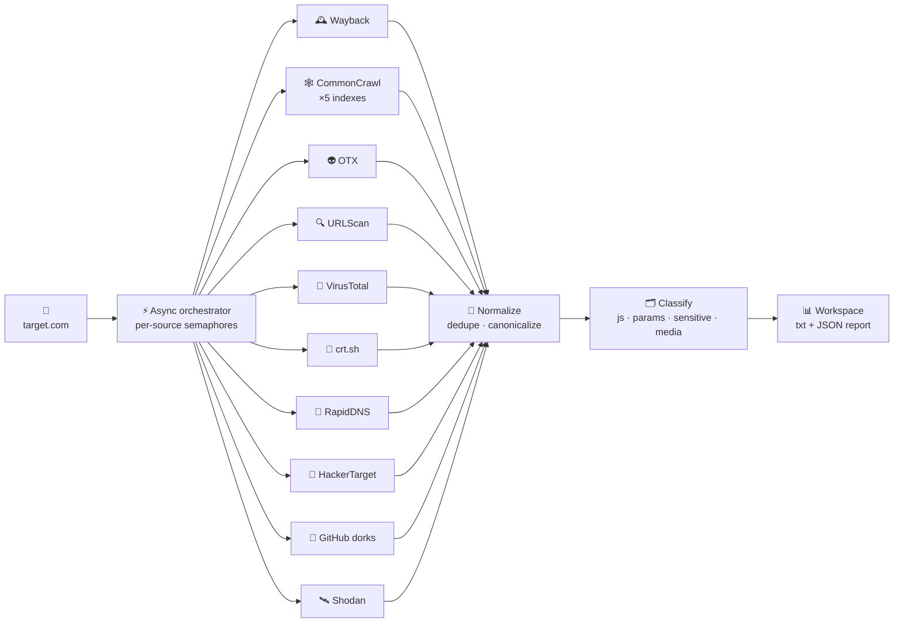

<div align="center">



### 🕷️ The last URL harvester you'll ever pipe into

**Ten passive intelligence sources. One command. Thousands of URLs in minutes —
categorized, deduplicated, and ready for your fuzzer.**

[](https://github.com/nkbeast/Spider-Crawl/releases)
[](https://www.python.org/)
[](LICENSE)
[](https://github.com/nkbeast/Spider-Crawl/stargazers)
[](https://github.com/nkbeast/Spider-Crawl/releases/latest)

**`Recon` · `Bug Bounty` · `OSINT` · `Async` · `Zero-config`**

</div>

---

## 🤔 Why Spider Crawl?

Every bug bounty engagement starts the same way: *how big is this target, really?*

Spider Crawl answers that question by querying **10 passive intelligence sources
in parallel** — Wayback Machine, Common Crawl, AlienVault OTX, URLScan, VirusTotal,
crt.sh, RapidDNS, HackerTarget, GitHub code search and Shodan — then merging,
normalizing and classifying everything into a clean workspace you can immediately
feed into `nuclei`, `ffuf`, `gf`, `dalfox`, or anything that reads a line-per-URL file.

No active scanning. No WAF tripping. Just the internet's memory of your target,
harvested at full async speed.

<div align="center"></div>

---

## ✨ Features

| | Feature | Details |
|---|---|---|
| ⚡ | **Fully async** | `aiohttp` + per-source semaphores — sources never block each other or hammer rate limits |
| 🌐 | **10 passive sources** | Wayback, CommonCrawl (5 indexes), OTX, URLScan, VirusTotal, crt.sh, RapidDNS, HackerTarget, GitHub dorks, Shodan |
| 🧹 | **Smart normalization** | URL dedup, scheme/port canonicalization, query sorting — same page, one entry |
| 🗂️ | **Auto-classification** | URLs auto-sorted into `js`, `params`, `sensitive`, `pdf`, `images`, `media` buckets |
| 🔑 | **Parameter mining** | Extracts every unique query-string key → perfect wordlist for param fuzzing |
| 🌍 | **Subdomain extraction** | Unique hosts harvested from all sources, no separate subfinder run needed |
| 📊 | **JSON reports** | Machine-readable per-domain summary with per-source counts and timing |
| 🔐 | **Secret-safe by design** | Keys live in env vars or a gitignored `.env` — nothing hardcoded, ever |
| 🧯 | **Resilient** | Exponential-backoff retries, 429/503-aware, non-fatal errors logged not crash |

---

## 🚀 Quick Start

```bash
git clone https://github.com/nkbeast/Spider-Crawl.git
cd Spider-Crawl
pip install -r requirements.txt

# crawl a single domain
python3 spidercrawl.py -d example.com
```

That's it. The 6 keyless sources (Wayback, CommonCrawl, OTX, crt.sh, RapidDNS,
HackerTarget) work out of the box — add API keys to unlock the rest.

### Requirements

- Python **3.9+**
- `aiohttp` + `rich` (installed via `requirements.txt`)

---

## 🔑 API Keys (optional but recommended)

Spider Crawl reads keys from the environment or from a local `.env` file —
**nothing is hardcoded** and `.env` is gitignored.

```bash
cp .env.example .env
```

| Variable | Source | Required | Unlock |
|---|---|---|---|
| `VIRUSTOTAL_API_KEY` | [virustotal.com](https://www.virustotal.com) — free tier | ❌ | URL + subdomain history (4 req/min on free) |
| `URLSCAN_API_KEY` | [urlscan.io](https://urlscan.io) — free tier | ❌ | Deep paginated scan search |
| `SHODAN_API_KEY` | [account.shodan.io](https://account.shodan.io) | ❌ | Full DNS subdomain map |
| `GITHUB_TOKEN` | [github.com/settings/tokens](https://github.com/settings/tokens) | ❌ | Code-search dorking (needed for the `github` source) |

> 💡 **GitHub PAT:** a classic token with **no scopes** (read-only public data) is
> enough. GitHub code search is capped at 10 req/min — Spider Crawl respects that
> automatically.

> 💡 Keys can also be passed as env vars (`GITHUB_TOKEN=... python3 spidercrawl.py -d target.com`)
> or per-run via `--github-token`.

---

## 🖥️ Usage

<div align="center"></div>

```text
usage: spidercrawl.py [-h] [-V] (-d DOMAIN | -l FILE) [-o DIR]
                      [--no-github] [--github-token TOKEN] [--proxy URL]
```

| Flag | Description |
|---|---|
| `-d, --domain DOMAIN` | Single target domain, e.g. `example.com` |
| `-l, --list FILE` | File with one domain per line — crawled sequentially |
| `-o, --output DIR` | Output directory (default: `./results`) |
| `--no-github` | Skip the GitHub code-dorking source |
| `--github-token TOKEN` | PAT for the GitHub source (overrides env) |
| `--proxy URL` | Route all traffic through an HTTP proxy (e.g. Burp `http://127.0.0.1:8080`) |
| `-V, --version` | Print version and exit |

### Examples

```bash
# single domain, custom output dir
python3 spidercrawl.py -d target.com -o ~/recon/target

# bulk mode — a whole bug bounty program
python3 spidercrawl.py -l wildcard-domains.txt -o ~/recon/program

# send traffic through Burp for full visibility
python3 spidercrawl.py -d target.com --proxy http://127.0.0.1:8080

# minimal run — free sources only, no token needed
python3 spidercrawl.py -d target.com --no-github
```

---

## 📁 Output Structure

Every domain gets a ready-to-pipe workspace:

```text
results/
├── urls/              # ← all unique URLs — feed into your fuzzer
│   └── target.com.txt
├── parameters/        # ← URLs with query strings
│   ├── target.com.txt
│   └── target.com_param_keys.txt   # unique param keys → gf/dalfox wordlist
├── js/                # ← JavaScript files → LinkFinder, secretz, jsfuzz
├── sensitive/         # ← .env, .sql, .bak, .pem, .zip … (manual review!)
├── pdfs/  images/  media/
├── subdomains/        # ← unique hosts discovered across all sources
│   └── target.com.txt
└── reports/           # ← machine-readable JSON summary per domain
    └── target.com.json
```

**Sample report:**

```json
{
  "domain": "target.com",
  "crawled_at": "2026-11-15T09:41:22.318407+00:00",
  "elapsed_seconds": 74.21,
  "total_unique_urls": 12847,
  "unique_subdomains": 96,
  "unique_param_keys": 142,
  "per_source": {
    "wayback": 9211,
    "commoncrawl": 3187,
    "alienvault": 402,
    "crtsh": 96,
    "rapiddns": 71,
    "hackertarget": 38
  }
}
```

---

## ⚙️ How It Works



**Rate-limit safety:** every source has its own semaphore, retries use
exponential backoff, and known rate-limit responses (Wayback `429/503`,
GitHub `10 req/min`, VirusTotal `4 req/min`) are handled explicitly —
so long runs don't get you banned.

---

## 🗺️ Roadmap

- [x] **v1.0.1** — initial public release: 10 passive sources, classification, JSON reports
- [ ] **v1.1** — pluggable custom sources (drop a Python file, get a source)
- [ ] **v1.2** — live crawling mode with JS endpoint extraction
- [ ] **v1.3** — diff mode: re-crawl and surface *new* URLs since last run
- [ ] **v1.4** — Docker image + one-liner install

---

## 🤝 Contributing

PRs are welcome! Good first issues: new passive sources, better classification
rules, output formats (CSV, SQLite). Please don't submit features that add
active-scanning noise — Spider Crawl is deliberately passive.

1. Fork → branch (`feat/my-source`) → commit → PR
2. Keep it stdlib + `aiohttp` + `rich` only

---

## ⚠️ Disclaimer

Spider Crawl queries **public, passive data sources** only — it never touches
the target directly. You are responsible for complying with the terms of those
sources, your bug bounty program's scope, and the laws of your jurisdiction.
Use it on targets **you are authorized to test**.

---

## 📜 License

[MIT](LICENSE) © 2026 Naveenkumar (nk)

<div align="center">

**If Spider Crawl saved you hours of recon, drop a ⭐ — it genuinely helps.**

`by nk — crawls everything.`

</div>
